

  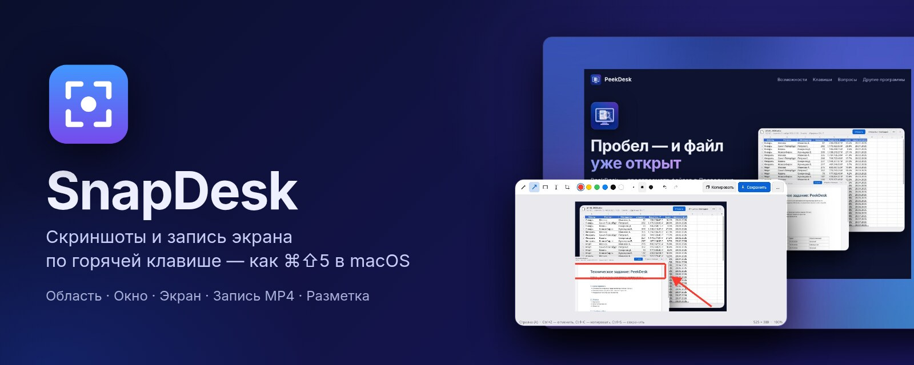

  
   Скачивается сразу ZIP с последней версией · <a href="https://github.com/NikoliniOFF/SnapDesk/releases">Все версии</a>

  
  
  

<h1 align="center">SnapDesk для Windows</h1>

  <b>Нажмите <kbd>Ctrl</kbd>+<kbd>Shift</kbd>+<kbd>5</kbd> — и снимите область, окно или весь экран. Или запишите видео.</b> 
  Снимок сразу в буфере обмена и в папке, а миниатюру в углу можно перетащить в Discord, Telegram или письмо. Как <kbd>⌘</kbd>+<kbd>⇧</kbd>+<kbd>5</kbd> в macOS, только для Windows 10 и 11. 
  Бесплатно · без установки · без рекламы и без слежки · обновляется сама.

---

## ✨ Что умеет

| | |
|---|---|
| 📸 **Панель снимков** | <kbd>Ctrl</kbd>+<kbd>Shift</kbd>+<kbd>5</kbd> — маленькая панель внизу экрана: область, окно, весь экран или запись. Для каждого режима есть своя горячая клавиша, все сочетания меняются в настройках. |
| ✂️ **Область** | Перекрестье с размером в пикселях и лупой 8× (с цветом под курсором), стрелки — точная подводка, <kbd>Пробел</kbd> — переключиться на окно. Экран замирает в момент нажатия, поэтому всплывающие меню и подсказки не пропадают. |
| 🪟 **Окно** | Наведите и щёлкните: снимается само окно, **даже если его перекрывают другие**. |
| 🎬 **Запись экрана** | Область, окно или весь экран в MP4 (H.264) — со звуком системы и микрофоном (каждый включается отдельно). 30 или 60 кадров, три уровня качества, курсор по желанию. Использует аппаратный кодер видеокарты, если он есть. Маленькая кнопка «стоп» с временем у верхнего края в сам ролик не попадает. |
| 🗂️ **Миниатюры стопкой** | После снимка в углу появляется миниатюра: щелчок — разметка, перетаскивание — файл в чат или папку, правый щелчок — меню. Несколько снимков подряд складываются стопкой (до 5), у каждой миниатюры свой таймер, наведение мыши его останавливает. |
| ✏️ **Разметка** | Перо, стрелка, прямоугольник, текст и обрезка, 6 цветов, 3 толщины, отмена и повтор. Копировать в буфер или сохранить — одной кнопкой. |
| 📋 **Сразу везде** | Снимок мгновенно попадает в буфер обмена (<kbd>Ctrl</kbd>+<kbd>V</kbd> в любой чат) и в папку «Изображения\Screenshots» в PNG. Ролики — в «Видео\Screen Recordings». Папки можно поменять. |
| ⚡ **Лёгкая** | В простое не тратит процессор совсем: никаких таймеров и хуков клавиатуры, только системные горячие клавиши. Всё тяжёлое (графика, кодирование видео) загружается в момент снимка и выгружается после. |
| 🎛️ **Всё отключается** | У каждой функции свой переключатель: буфер, сохранение, миниатюры, стопка, звук затвора, запись, звук, курсор, плавные анимации, автозапуск. |
| 🌗 **Светлая и тёмная тема** | Следует теме Windows или выбирается вручную. Панель и миниатюры появляются и гаснут плавно. |
| 👀 **Вместе с PeekDesk** | «Открыть в PeekDesk» в меню миниатюры — если установлен [PeekDesk](https://github.com/NikoliniOFF/PeekDesk). |

## 📸 Как это выглядит

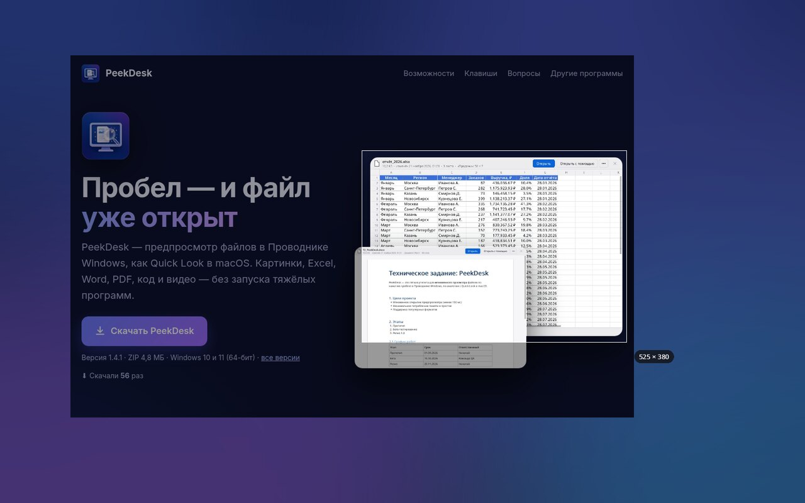

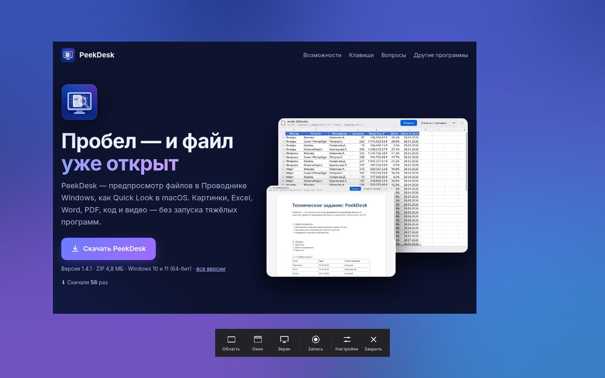 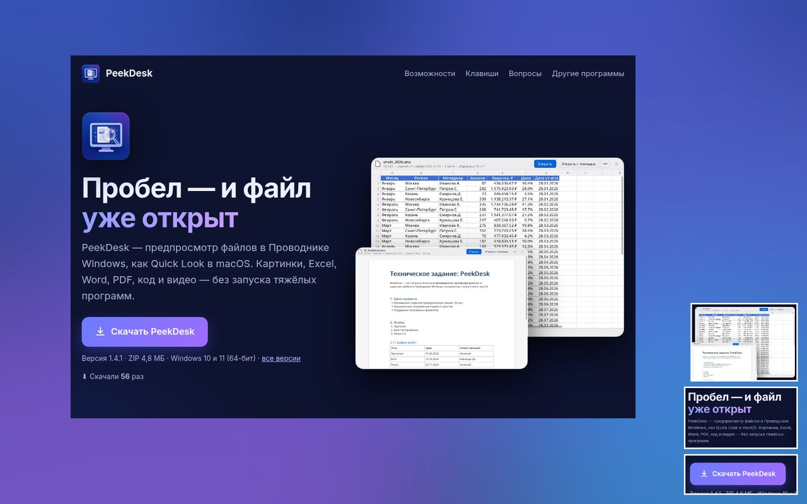

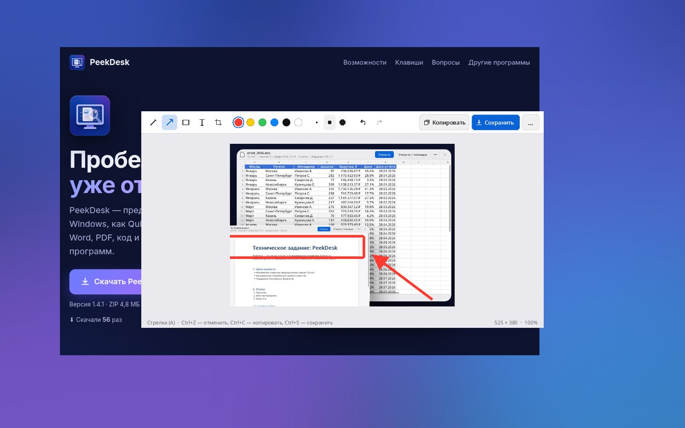 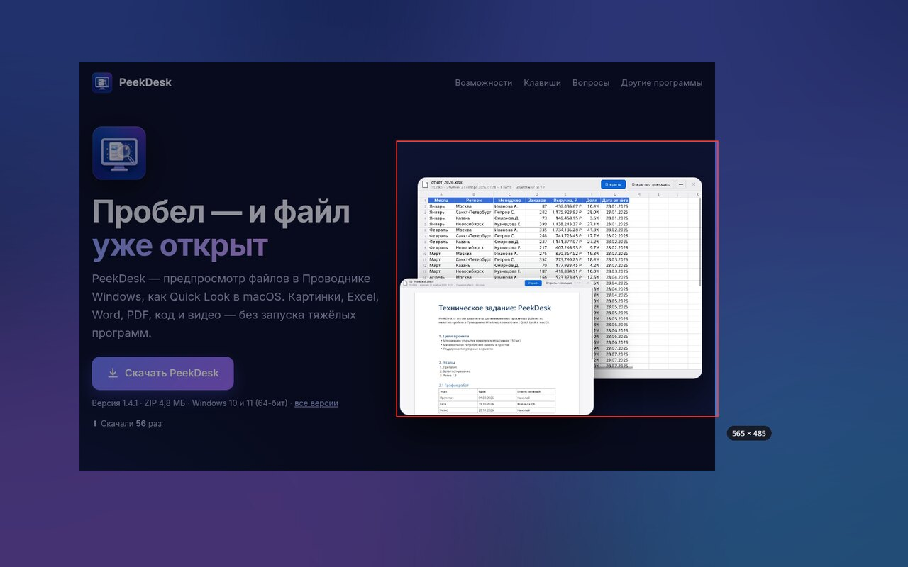

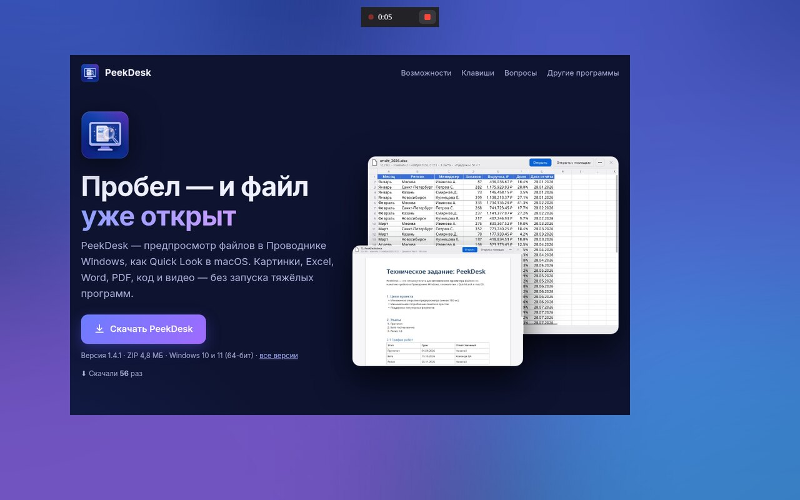 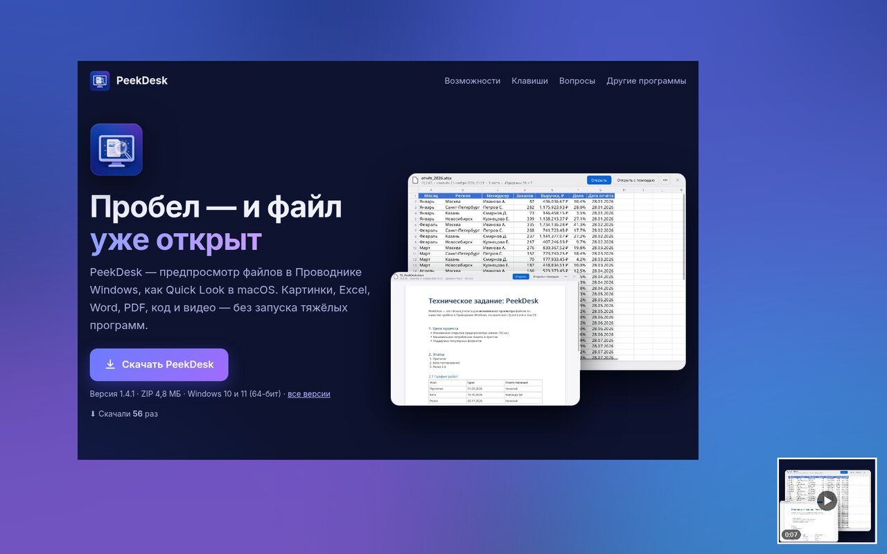

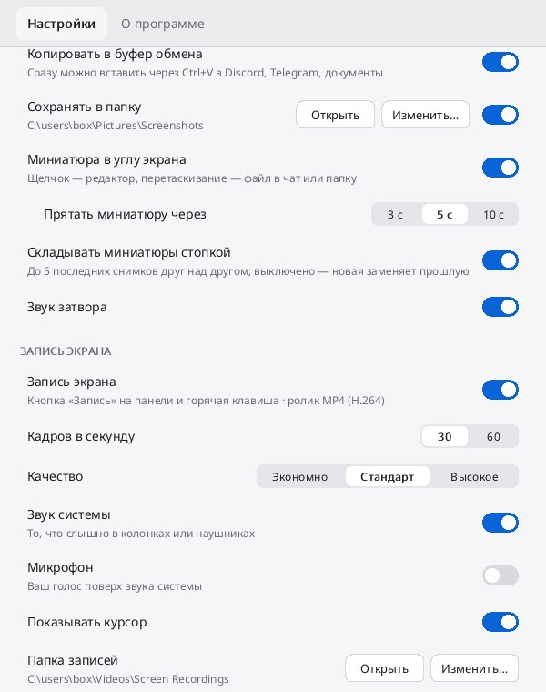 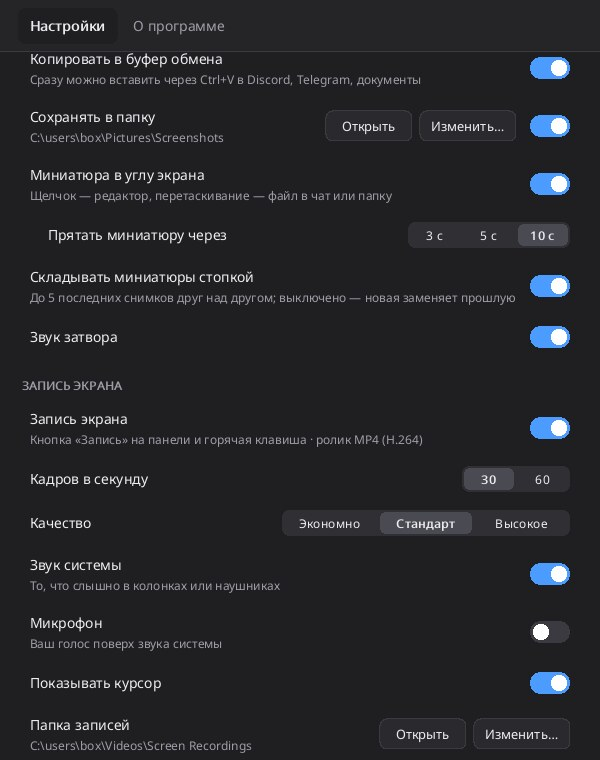 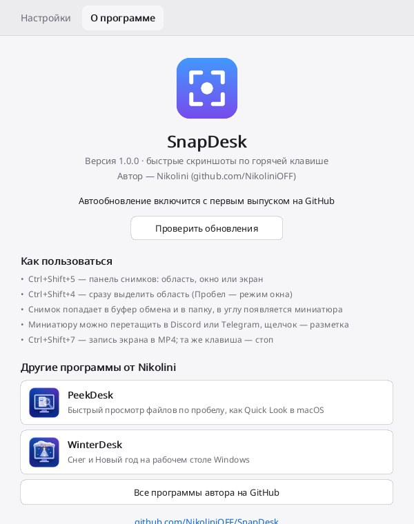

## 📥 Как установить

1. Скачайте **[SnapDesk-win64.zip](https://github.com/NikoliniOFF/SnapDesk/releases/latest/download/SnapDesk-win64.zip)** (или выберите файл на странице [последней версии](https://github.com/NikoliniOFF/SnapDesk/releases/latest)).
2. Распакуйте архив в постоянную папку, например `Документы\SnapDesk`.
3. Запустите **SnapDesk.exe** — значок появится в трее у часов. Нажмите <kbd>Ctrl</kbd>+<kbd>Shift</kbd>+<kbd>5</kbd>.
4. Если Windows покажет синее окно *«Система Windows защитила ваш компьютер»*, нажмите **«Подробнее» → «Выполнить в любом случае»** (подробнее — в разделе «Вопросы»).

> Устанавливать ничего не нужно: SnapDesk — одна программа. При первом запуске он добавляет себя в автозапуск, чтобы клавиши работали сразу после входа в Windows (выключается в настройках). Чтобы удалить, выберите «Выход» в меню значка и удалите папку.

## ⌨️ Клавиши

| Клавиша | Действие |
|---|---|
| <kbd>Ctrl</kbd>+<kbd>Shift</kbd>+<kbd>5</kbd> | панель снимков: область, окно, экран, запись (на панели — <kbd>1</kbd> <kbd>2</kbd> <kbd>3</kbd>, <kbd>4</kbd> или <kbd>R</kbd> — запись, <kbd>Esc</kbd> — закрыть) |
| <kbd>Ctrl</kbd>+<kbd>Shift</kbd>+<kbd>4</kbd> | сразу выделить область |
| <kbd>Ctrl</kbd>+<kbd>Shift</kbd>+<kbd>6</kbd> | снимок окна под курсором (щелчок по окну) |
| <kbd>Ctrl</kbd>+<kbd>Shift</kbd>+<kbd>3</kbd> | снимок всего экрана |
| <kbd>Ctrl</kbd>+<kbd>Shift</kbd>+<kbd>7</kbd> | запись экрана: выделите область, щёлкните окно или нажмите <kbd>F</kbd> — весь экран; та же клавиша останавливает запись |
| <kbd>Пробел</kbd> · стрелки · <kbd>F</kbd> · <kbd>Esc</kbd> | при выделении: режим окна, точная подводка, весь монитор, отмена |
| <kbd>P</kbd> <kbd>A</kbd> <kbd>R</kbd> <kbd>T</kbd> <kbd>C</kbd> | разметка: перо, стрелка, прямоугольник, текст, обрезка |
| <kbd>Ctrl</kbd>+<kbd>Z</kbd> / <kbd>Ctrl</kbd>+<kbd>Y</kbd> · <kbd>Ctrl</kbd>+<kbd>C</kbd> · <kbd>Ctrl</kbd>+<kbd>S</kbd> | разметка: отменить / повторить, копировать, сохранить (<kbd>Ctrl</kbd>+<kbd>Shift</kbd>+<kbd>S</kbd> — сохранить как) |

Все сочетания меняются в настройках; любое можно выключить. Если сочетание уже занято другой программой, SnapDesk скажет об этом.

## ⚙️ Настройки

Щёлкните значок SnapDesk в трее (справа внизу, у часов) → **«Настройки»**. Там горячие клавиши, что делать после снимка (буфер, папка, миниатюра, стопка, звук затвора), запись экрана (кадры, качество, звук системы, микрофон, курсор, папка роликов), тема, плавные анимации, автозапуск и обновления.

Настройки хранятся в `%APPDATA%\SnapDesk\settings.ini`.

## 🔄 Как обновлять

SnapDesk сам проверяет новые версии на этой странице: через минуту после запуска и затем раз в 12 часов. В настройках, раздел **«Новые версии»**, можно выбрать **«Автоматически»**, **«Спрашивать»** *(по умолчанию)* или **«Не проверять»** (тогда — пункт «Проверить обновления» в меню значка). Каждый выпуск проверяется по размеру и контрольной сумме SHA-256, настройки сохраняются.

## 🧰 Требования

- Windows 10 (версия 1903 или новее) или Windows 11, 64-бит.
- Для записи экрана — компоненты мультимедиа Windows (они есть везде, кроме выпусков «N»; для них — бесплатный «Пакет дополнительных компонентов мультимедиа» от Microsoft).

## ❓ Вопросы

<b>Windows пишет «Система Windows защитила ваш компьютер»</b>

Это фильтр SmartScreen: программа новая и пока не подписана платным сертификатом. Нажмите **«Подробнее»**, затем **«Выполнить в любом случае»**. Скачивайте SnapDesk только со [страницы выпусков](https://github.com/NikoliniOFF/SnapDesk/releases) — рядом с каждым архивом лежит файл `.sha256` с контрольной суммой.

<b>Не будет ли тормозить компьютер?</b>

Нет. В трее SnapDesk ничего не делает и ничего не опрашивает — просыпается только по горячей клавише. Графика и кодировщик видео загружаются в момент снимка или записи и выгружаются после.

<b>Куда сохраняются снимки и ролики?</b>

Снимки — в `Изображения\Screenshots` (туда же, куда кладёт Win+PrintScreen), ролики — в `Видео\Screen Recordings` (рядом с записями «Ножниц»). Обе папки меняются в настройках, сохранение в папку можно выключить — тогда снимок остаётся только в буфере обмена.

<b>Попадёт ли кнопка «стоп» или миниатюра в запись?</b>

Нет. Кнопка «стоп» и миниатюры скрыты от записи (Windows 10 2004 и новее), а перед снимком SnapDesk сам убирает свои окна с экрана.

<b>Сочетание Ctrl+Shift+5 занято другой программой</b>

Откройте настройки, щёлкните по сочетанию и нажмите новое. Каждое сочетание можно и выключить — тогда пользуйтесь меню значка в трее.

<b>Программа что-нибудь собирает или отправляет?</b>

Нет. Без рекламы и без слежки: снимки и ролики остаются только на вашем компьютере. В интернет SnapDesk обращается лишь к GitHub, чтобы проверить обновления, — это можно выключить.

## 🧩 Другие программы от Nikolini

<table>
  <tr>
    <td width="96" align="center"><a href="https://nikolinioff.github.io/PeekDesk/">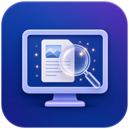</a></td>
    <td>
      <b><a href="https://nikolinioff.github.io/PeekDesk/">PeekDesk</a></b> — предпросмотр файлов по пробелу в Проводнике, как Quick Look в macOS: картинки, Excel, Word, PDF, код, видео и архивы. 
      <a href="https://nikolinioff.github.io/PeekDesk/">Сайт</a> · <a href="https://github.com/NikoliniOFF/PeekDesk">GitHub</a>
    </td>
  </tr>
  <tr>
    <td width="96" align="center"><a href="https://nikolinioff.github.io/WinterDesk/">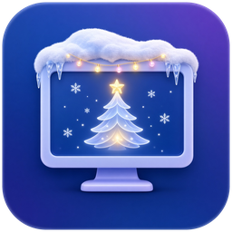</a></td>
    <td>
      <b><a href="https://nikolinioff.github.io/WinterDesk/">WinterDesk</a></b> — снег на рабочем столе Windows: сугробы на окнах, гирлянды, ёлочка и отсчёт до Нового года. 
      <a href="https://nikolinioff.github.io/WinterDesk/">Сайт</a> · <a href="https://github.com/NikoliniOFF/WinterDesk">GitHub</a>
    </td>
  </tr>
  <!-- Новая программа: скопируйте строку <tr>…</tr> выше и поменяйте значок, название, описание и ссылки. -->
</table>

Все программы — на [github.com/NikoliniOFF](https://github.com/NikoliniOFF).

## 💬 Обсуждение

- 💡 [Предложить идею](https://github.com/NikoliniOFF/SnapDesk/discussions/new/choose)
- 🐞 [Сообщить о баге](https://github.com/NikoliniOFF/SnapDesk/issues/new?template=bug.yml)
- 💬 [Все обсуждения](https://github.com/NikoliniOFF/SnapDesk/discussions)

---

SnapDesk · автор — <a href="https://github.com/NikoliniOFF">Nikolini (NikoliniOFF)</a> · бесплатно, без рекламы и без слежки

